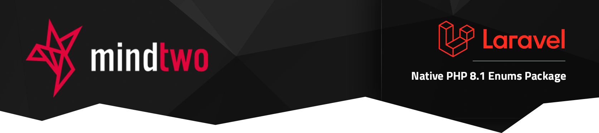

# Enhanced Native PHP Enums for Laravel

[![Latest Version on Packagist][ico-version]][link-packagist]
[![Software License][ico-license]](LICENSE.md)
[![Total Downloads][ico-downloads]][link-downloads]

[][link-author]

`mindtwo/native-enum` makes PHP's native enums convenient to use in Laravel. Add the `BaseEnum` trait to a backed enum and it gains helper methods, validation rules, Eloquent casts, localized labels and a Blade component that hands its cases to JavaScript.

Inspired by [BenSampo/laravel-enum][link-laravel-enum], this package builds on PHP's native enum classes instead of constant classes. Everyone is welcome to contribute.

## Contents

- [Requirements](#requirements)
- [Installation](#installation)
- [Quick start](#quick-start)
  - [Create an enum](#create-an-enum)
  - [Use the helpers](#use-the-helpers)
  - [Validate input](#validate-input)
  - [Cast model attributes](#cast-model-attributes)
  - [Localize labels](#localize-labels)
  - [Livewire and JavaScript](#livewire-and-javascript)
- [Good to know](#good-to-know)
- [Documentation](#documentation)
- [Change log](#change-log)
- [Testing](#testing)
- [Contributing](#contributing)
- [Security](#security)
- [Credits](#credits)
- [License](#license)

## Requirements

- PHP 8.2 or higher
- Laravel 8 or higher

## Installation

```bash
composer require mindtwo/native-enum
```

The service provider is registered through Laravel's package discovery, so there is nothing else to set up. Stubs, validation translations and the config file can be published when you need them, see [Get started](docs/get-started.md#publish-optional-assets).

## Quick start

### Create an enum

```bash
php artisan make:enum UserRole
```

This creates `App\Enums\UserRole`. Add `--localized` for an enum with translated labels. You can also write the enum by hand. All it needs is a backing type and the `BaseEnum` trait:

```php
namespace App\Enums;

use mindtwo\NativeEnum\BaseEnum;

enum UserRole: int
{
    use BaseEnum;

    case ADMIN = 10;
    case CUSTOMER = 50;
}
```

More: [Creating enums](docs/creating-enums.md) covers namespaces and custom stubs.

### Use the helpers

```php
UserRole::getValues();        // [10, 50]
UserRole::getNames();         // ['ADMIN', 'CUSTOMER']
UserRole::asArray();          // [10 => 'ADMIN', 50 => 'CUSTOMER']
UserRole::asSelectArray();    // [10 => 'ADMIN', 50 => 'CUSTOMER'], value => label, sorted by label

UserRole::getInstance(10);    // UserRole::ADMIN
UserRole::getName(10);        // 'ADMIN'
UserRole::getValue('ADMIN');  // 10
UserRole::ADMIN();            // 10

UserRole::hasValue(10);       // true
UserRole::hasName('ADMIN');   // true
```

More: [Helper methods](docs/helpers.md) lists every method with its return value.

### Validate input

```php
use mindtwo\NativeEnum\Rules\EnumName;
use mindtwo\NativeEnum\Rules\EnumValue;

$request->validate([
    'role' => ['required', new EnumValue(UserRole::class, false)], // 10 or "10"
    'sort' => ['required', new EnumName(UserRole::class)],         // "ADMIN"
]);
```

`EnumValue` is strict by default, so the string `"10"` fails for an int-backed enum. Pass `false` as shown for form and query-string input, which always arrives as strings. A third rule, `Enum`, checks for a case instance.

More: [Validation](docs/validation.md) covers the string syntax and error messages.

### Cast model attributes

The enum has to implement Laravel's `Castable` contract. The trait already provides the `castUsing()` method the contract asks for:

```php
use Illuminate\Contracts\Database\Eloquent\Castable;
use mindtwo\NativeEnum\BaseEnum;

enum UserRole: int implements Castable
{
    use BaseEnum;

    case ADMIN = 10;
    case CUSTOMER = 50;
}
```

```php
class User extends Model
{
    protected $casts = [
        'role' => UserRole::class,
    ];
}
```

| Cast | Column content | Attribute value |
| --- | --- | --- |
| `UserRole::class` | `10` | `UserRole::ADMIN` |
| `UserRole::class.':nullable'` | `10` or `NULL` | `UserRole::ADMIN` or `null` |
| `UserRole::class.':collection'` | `[10,50]` (JSON) | array of cases |
| `UserRole::class.':collection,comma'` | `10,50` (text) | array of cases |

More: [Eloquent casts](docs/casts.md) covers column types, modifiers and caveats.

### Localize labels

Implement `LocalizedEnum` and put the labels into `lang/{locale}/enums.php`:

```php
use mindtwo\NativeEnum\BaseEnum;
use mindtwo\NativeEnum\Contracts\LocalizedEnum;

enum UserRole: int implements LocalizedEnum
{
    use BaseEnum;

    case ADMIN = 10;
    case CUSTOMER = 50;
}
```

```php
// lang/en/enums.php
return [
    \App\Enums\UserRole::class => [
        'ADMIN' => 'Administrator',
        'CUSTOMER' => 'Customer',
    ],
];
```

```php
UserRole::ADMIN->name();    // 'Administrator'
UserRole::ADMIN->name;      // 'ADMIN'
UserRole::asSelectArray();  // [10 => 'Administrator', 50 => 'Customer']
```

More: [Localization](docs/localization.md) covers fallbacks and custom translation keys.

### Livewire and JavaScript

- **Livewire:** enums can be typed public properties on a component. See [Livewire](docs/livewire.md).
- **JavaScript:** `<x-m2-enums::serve />` exposes the enums listed in `config/enums.php` as `window.m2_ServedEnums`. See [Serving enums to JavaScript](docs/javascript.md).

## Good to know

- **Lookups compare strictly.** `UserRole::getInstance('10')` does not match the int value `10`, and neither does assigning `'10'` to a cast attribute. Convert request input first, for example `UserRole::from((int) $request->input('role'))`.
- **Unknown values throw.** `getInstance()`, `getName()` and `getValue()` throw `Illuminate\Support\ItemNotFoundException` when nothing matches. Check with `hasValue()` or `hasName()` if the input has not been validated.
- **Casts need `Castable`.** Without it, `'role' => UserRole::class` falls back to Laravel's own enum cast, and the `:nullable` and `:collection` modifiers fail.
- **Random helpers are not secure.** `getRandomValue()`, `getRandomName()` and `getRandomInstance()` use `array_rand()`. Don't use them for tokens or IDs.

## Documentation

| Page | Covers |
| --- | --- |
| [Get started](docs/get-started.md) | Requirements, installation, publishable assets, your first enum |
| [Creating enums](docs/creating-enums.md) | `make:enum`, namespaces, custom stubs, writing an enum by hand |
| [Helper methods](docs/helpers.md) | Every method `BaseEnum` adds, with return values |
| [Validation](docs/validation.md) | `EnumValue`, `EnumName`, `Enum`, string syntax, error messages |
| [Eloquent casts](docs/casts.md) | Single values, `:nullable`, `:collection`, `:collection,comma` |
| [Localization](docs/localization.md) | `LocalizedEnum`, lang files, translated labels |
| [Livewire](docs/livewire.md) | Enum properties on components |
| [Serving enums to JavaScript](docs/javascript.md) | `<x-m2-enums::serve />` and `window.m2_ServedEnums` |

## Change log

Please see [CHANGELOG](CHANGELOG.md) for more information on what has changed recently.

## Testing

```bash
composer test
```

The test suite is plain PHPUnit and does not need a booted Laravel application.

## Contributing

Please see [CONTRIBUTING](CONTRIBUTING.md) and [CODE_OF_CONDUCT](CODE_OF_CONDUCT.md) for details.

## Security

If you discover any security related issues, please email info@mindtwo.de instead of using the issue tracker.

## Credits

- [All Devs @ mindtwo][link-author]
- [BenSampo/laravel-enum][link-laravel-enum]
- [archtechx/enums][link-archtechx-enums]
- [All Contributors][link-contributors]

## License

The MIT License (MIT). Please see [License File](LICENSE.md) for more information.

[ico-version]: https://img.shields.io/packagist/v/mindtwo/native-enum.svg?style=flat-square
[ico-license]: https://img.shields.io/badge/license-MIT-brightgreen.svg?style=flat-square
[ico-downloads]: https://img.shields.io/packagist/dt/mindtwo/native-enum.svg?style=flat-square

[link-packagist]: https://packagist.org/packages/mindtwo/native-enum
[link-downloads]: https://packagist.org/packages/mindtwo/native-enum
[link-author]: https://www.mindtwo.de/digitalagentur
[link-laravel-enum]: https://github.com/BenSampo/laravel-enum
[link-archtechx-enums]: https://github.com/archtechx/enums
[link-contributors]: ../../contributors


[](#)
